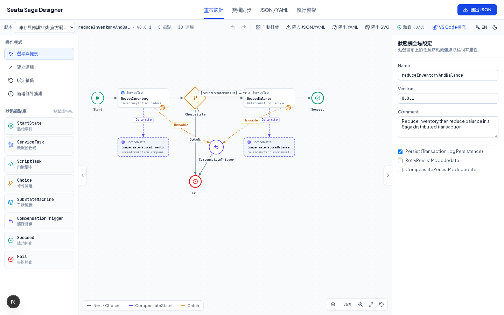

# 01. 總覽與快速入門指南

> 認識 Apache Seata Saga State Machine Designer 的完整工作區架構、內建官方範例與 3 分鐘建立第一個分散式事務狀態機的操作流程。

**分類**：快速入門 · **閱讀時間**：4 分鐘閱讀

## 工作區介面導覽

Seata Saga State Machine Designer 採用高效率的四區域桌面工程版面，將視覺化流程設計、屬性檢查、JSON/YAML 雙向編輯、執行補償模擬與 VS Code 擴充整合集中在單一工作區中。

開啟應用程式後，系統會自動載入 Apache Seata 官方經典範例 reduceInventoryAndBalance（庫存與餘額扣減），讓您立即體驗完整的正向流程、條件分支與例外補償拓樸。

*圖 1-1：主工作區介面總覽，包含頂部檢視切換列、工作列、左側狀態節點庫、中央互動畫布與右側屬性檢查器。*

- **頂部導覽列**：切換「畫布設計」、「雙欄同步」、「JSON / YAML」、「執行模擬」與「說明文件」，右側提供一鍵「匯出 JSON」。
- **工作列**：切換內建範本、檢視目前狀態機名稱與節點數，執行復原/重做、自動排版、匯入/匯出 YAML 與 SVG、結構驗證、開啟 VS Code 擴充整合，以及切換語系（繁中/EN）與深淺色主題。
- **左側節點庫與邊緣鉗鈕**：提供 4 種畫布操作模式與 8 種官方 Seata 狀態節點，支援點擊加入或拖曳至畫布任意座標，並可透過邊緣鉗鈕一鍵收合。
- **右側屬性檢查器**：未選取節點時顯示狀態機全域設定（Name、Version、Persist 等）；點選節點或連線時即時切換為對應屬性表單。

## 三步驟建立第一個 Saga 狀態機

無論是從零開始建立新流程，或改寫既有的微服務分散式事務定義，都可依照以下三個步驟快速完成並驗證：

1. 選擇起始範本：在工作列「範本」下拉選單中，選擇「庫存與餘額扣減」、「訂單履約與子狀態機（多層範例）」或「空白起始範本」。
2. 視覺化編排流程：從左側節點庫拖曳 ServiceTask、Choice、ScriptTask 或 SubStateMachine 至畫布，拖曳節點右側藍色連接點建立 Next / Choice / Catch / CompensateState 連線，並在右側面板填寫 ServiceName、ServiceMethod 與 Input/Output 參數。
3. 驗證、模擬並匯出：點擊工作列「驗證」確認 0 錯誤，切換至「執行模擬」測試失敗與補償回滾路徑，最後匯出為保留完整座標與註解的 YAML 或 JSON 定義檔。

## 常用鍵盤快捷鍵與偏好設定

設計器內建與桌面工程工具一致的鍵盤快捷鍵，在非文字輸入狀態下皆可直接觸發：

| 快捷鍵 / 控制項 | 功能說明 | 適用範圍 |
| --- | --- | --- |
| Ctrl + Z / Cmd + Z | 復原上一步畫布或屬性變更（每個子狀態機獨立維護歷史） | 畫布與雙欄模式 |
| Ctrl + Y / Shift + Ctrl + Z | 重做已復原的變更 | 畫布與雙欄模式 |
| Alt + ← | 從 SubStateMachine 子狀態機快速返回上一層父狀態機 | 巢狀子狀態機檢視 |
| Escape | 取消目前連線模式或關閉開啟中的彈窗 | 全域 |
| 滑鼠滾輪 / 空白拖曳畫布 | 平滑縮放畫布（40%–200%）與平移視野，左下角提供適應畫面與重設縮放 | 畫布區域 |
