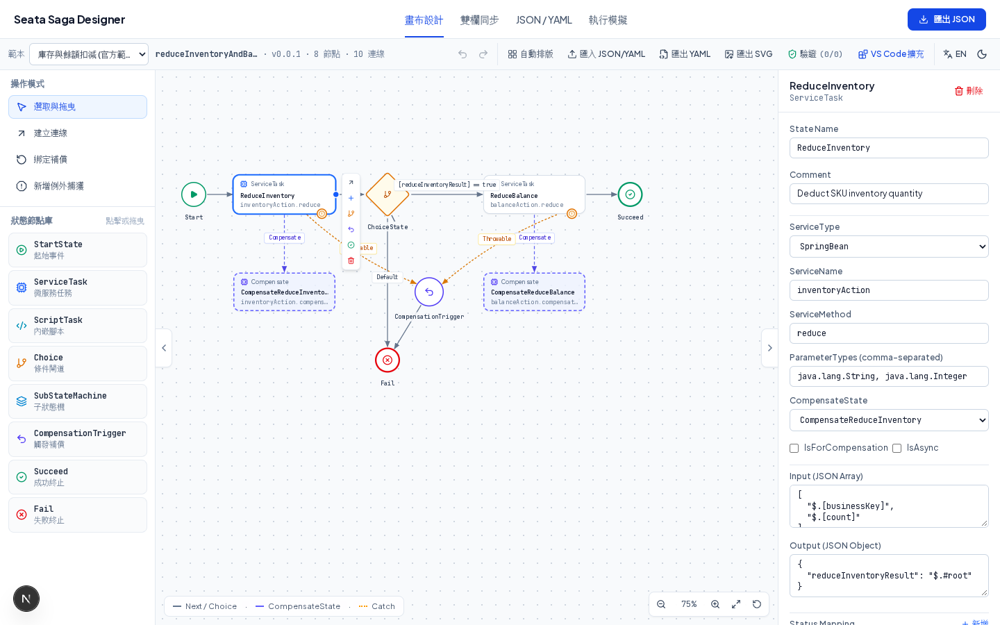

# 02. 視覺化畫布與 Seata 狀態節點指南

> 深入了解 8 種 Apache Seata 官方狀態節點、4 種流程與補償連線語意、節點快速工具列，以及左右可收合邊緣鉗鈕的高效畫布操作技巧。

**分類**：視覺化設計 · **閱讀時間**：6 分鐘閱讀

## 互動畫布、快速工具列與可收合左右邊緣鉗鈕

點選畫布上任意狀態節點後，節點右側會出現懸浮式快速操作列，無須切換游標模式即可一鍵延伸下一個 ServiceTask、Choice 分支、綁定補償任務（CompensateState）、接續 Succeed 終點或刪除節點。

當流程圖較寬或在筆電螢幕上作業時，點擊左側節點庫右緣與右側面板左緣的「邊緣鉗鈕」，即可平滑隱藏側欄，將 100% 寬度釋放給中央畫布。

*圖 2-1：點選 ReduceInventory 節點後，顯示懸浮快速操作列、右側 ServiceTask 完整屬性（SpringBean、參數型別、補償任務與 Status Mapping）以及左右面板邊緣鉗鈕。*

## 8 種官方 Seata Saga 狀態節點完整對照

設計器完整對齊 Apache Seata STATE_LANG 規範，支援全部 8 類節點與其專屬視覺辨識樣式：

| 節點類型 | 中文名稱 | 核心用途與關鍵屬性 |
| --- | --- | --- |
| StartState | 起始事件 | 標示整個狀態機的進入點，對應頂層 StartState 屬性；每個狀態機僅允許一個起始節點。 |
| ServiceTask | 微服務任務 | 呼叫遠端或本地微服務（SpringBean / Dubbo / SofaRPC），支援 CompensateState、Input/Output、Status Mapping、Retry 與 Catch。 |
| ScriptTask | 內嵌腳本 | 執行 Groovy 等內嵌運算腳本（ScriptType、ScriptContent），常用於風控評分、規則計算或資料轉換。 |
| Choice | 條件閘道 | 依 SpEL 條件運算式（Choices[]）將流程導向不同分支，並支援 Default 預設路徑。 |
| SubStateMachine | 子狀態機 | 以 StateMachineName 委派呼叫另一組獨立 Saga 狀態機；支援畫布雙擊直接鑽取編輯與跨層補償。 |
| CompensationTrigger | 觸發補償 | 接收失敗或例外路徑後，通知 Seata 引擎以 LIFO（後進先出）順序反向補償所有已成功的任務。 |
| Succeed | 成功終止 | 標記分散式事務順利完成並提交結束狀態。 |
| Fail | 失敗終止 | 標記流程異常終止，可設定 ErrorCode 與 Message 供上游系統識別。 |

## 4 種連線語意與自動拓樸排版

畫布底部圖例清楚區分流程中的 4 種連線語意：實線灰藍箭頭代表一般順序轉移（Next）或條件分支（Choice / Default）；紫色虛線代表補償綁定（CompensateState）；橘色點線代表例外捕獲（Catch）。

若手動拖曳後連線交錯，隨時點擊工作列「自動排版」按鈕，演算法會依據拓樸層級自動排列主流程，並將所有 IsForCompensation 補償節點整齊對齊於其對應正向任務正下方。

> **快速建立補償任務的小技巧**
> 選取任何 ServiceTask 後，直接點擊節點右側懸浮工具列的「紫色回轉箭頭」圖示，設計器會自動在正下方建立已勾選 IsForCompensation 的補償 ServiceTask 並完成 CompensateState 連線綁定。
