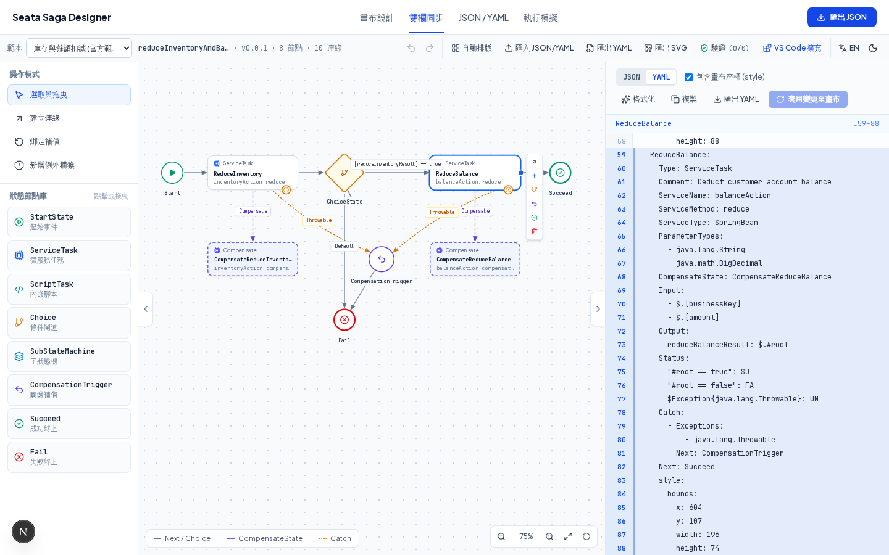

# 03. 雙欄同步與行號閃爍定位

> 同時開啟視覺化畫布與 JSON/YAML 程式碼面板，體驗點選節點或連線時自動捲動至精確行號並以特效閃爍標示區塊的流暢工作流。

**分類**：雙欄同步 · **閱讀時間**：4 分鐘閱讀

## 點選畫布即時定位與區塊閃爍特效

切換至頂部導覽列的「雙欄同步」後，右側面板會展開具備同步行號列（Line Gutter）的程式碼編輯器，支援在 JSON 與 YAML 之間隨時切換。

當您在左側畫布點擊任何狀態節點（例如 ReduceBalance）或任一條轉移／補償／例外連線時，底層的 Source Locator 會精確計算該元素在目前原始碼中的起始與結束行號，在 240 毫秒內平滑捲動至視窗中央，並以藍色光暈區塊閃爍提示，同時於頂部列顯示精確範圍標籤（例如 ReduceBalance · L59-88）。

*圖 3-1：雙欄同步模式下點擊畫布中的 ReduceBalance 節點，右側 YAML 面板自動跳轉至 L59-88 行並觸發藍色區塊閃爍高亮。*

## 雙向同步與 style.bounds 座標控制

在畫布上拖曳節點、修改屬性或連線時，右側 JSON/YAML 會即時反映最新結構；反之，當您直接在右側編輯器修改原始碼時，「套用變更至畫布」按鈕會亮起，點擊後即可即時解析並重繪畫布。

頂部的「包含畫布座標 (style)」核取方塊可控制輸出是否保留每個節點的 style.bounds（x、y、width、height）資訊：開發設計期建議保持勾選以保留排版，部署至極簡執行環境時可取消勾選以產出純語意定義檔。

> **支援點選連線定位特定欄位**
> 不僅是節點，點擊畫布上的 Choice 條件標籤、Compensate 紫色虛線或 Throwable 橘色例外線時，右側程式碼會直接跳轉並高亮對應的 Choices、CompensateState 或 Catch 區段行號。
