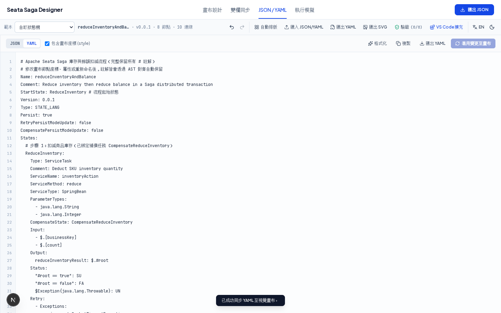

# 04. YAML 匯入匯出與 # 註解保留技術

> 了解設計器如何透過 YAML v2 AST 樹狀結構對齊機制，在視覺化拖曳、屬性修改與節點重命名過程中完整保留所有 # 註解說明。

**分類**：YAML 工程化 · **閱讀時間**：5 分鐘閱讀

## 匯入、編輯並完整保留所有 # 註解

實務上團隊經常在 Seata Saga YAML 設定檔中撰寫豐富的業務說明、風控門檻理由與維運聯絡註解。傳統「JSON.parse → YAML.stringify」流程會無條件丟棄所有 # 註解，導致視覺化工具難以融入 Git 團隊協作。

本設計器採用基於 AST（抽象語法樹）的無損調和演算法：無論是檔案表頭註解、區塊前註解（commentBefore）、行尾註解（inline # comment）、陣列項目註解或檔尾註解，在畫布進行節點拖曳、調整 Catch 邊界錨點（style.sourceAnchor）或重新命名後重新匯出 YAML 時，全部都會精準保留於對應位置。同時支援以 --- 分隔的多文件 YAML 一次批次匯入，且每份文件皆獨立保存各自的註解範本。



*圖 4-1：於 JSON/YAML 檢視中匯入含表頭註解、StartState 行尾註解與 ReduceInventory 區塊註解的 YAML，點擊「套用變更至畫布」後註解結構完全保留。*

## YAML AST 註解保留調和管線原理

每次匯入或套用 YAML 時，系統除了將其轉換為視覺化圖形模型（SagaGraph）外，還會將原始 YAML 文本快照保存為 yamlTemplate。當使用者在畫布上修改節點或重新命名狀態時，序列化器會重新解析 yamlTemplate 的 Document AST，僅針對實際變動的鍵值進行就地更新或鍵名遷移，從而完整守住每一個註解節點與原本的屬性順序。

### YAML v2 AST 註解無損調和管線

*架構圖 4-1：YAML 原始碼同時建立視覺圖形與 AST 註解範本，經畫布編輯與重命名調和後輸出無損註解的 .saga.yaml。*

## 支援註解保留的 Seata Saga YAML 範例

您可以直接複製以下含完整註解的 YAML 範例貼入「JSON / YAML」檢視，或存檔為 .saga.yaml 透過工作列「匯入 JSON/YAML」載入測試：

**orderInventory.saga.yaml**

```yaml
# Apache Seata Saga 庫存與餘額扣減流程
# 團隊規範：所有正向 ServiceTask 均需綁定 CompensateState
Name: reduceInventoryAndBalance
Comment: Reduce inventory then reduce balance
StartState: ReduceInventory # 流程起始節點
Version: 1.0.0
Type: STATE_LANG
Persist: true
States:
  # 步驟 1：扣減商品庫存（失敗時由 CompensateReduceInventory 回補）
  ReduceInventory:
    Type: ServiceTask
    ServiceName: inventoryAction
    ServiceMethod: reduce
    ServiceType: SpringBean
    CompensateState: CompensateReduceInventory # 綁定補償節點
    Input:
      - $. [businessKey] # 訂單唯一業務鍵
      - $. [count]       # 購買數量
    Next: Succeed
```
