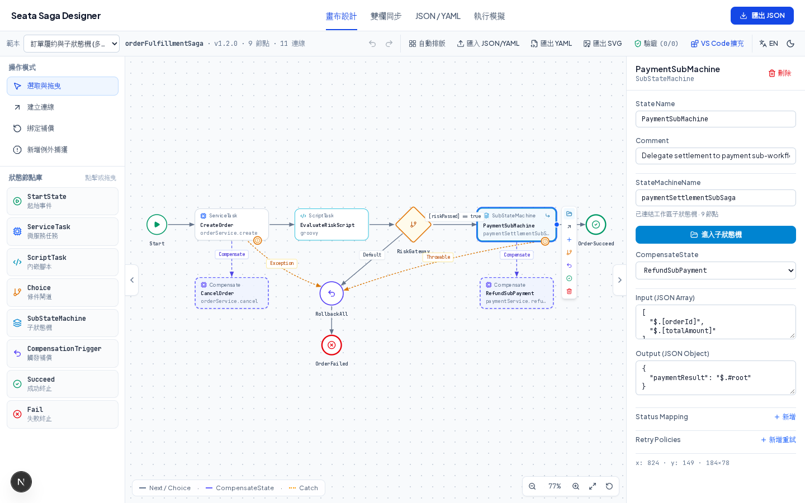
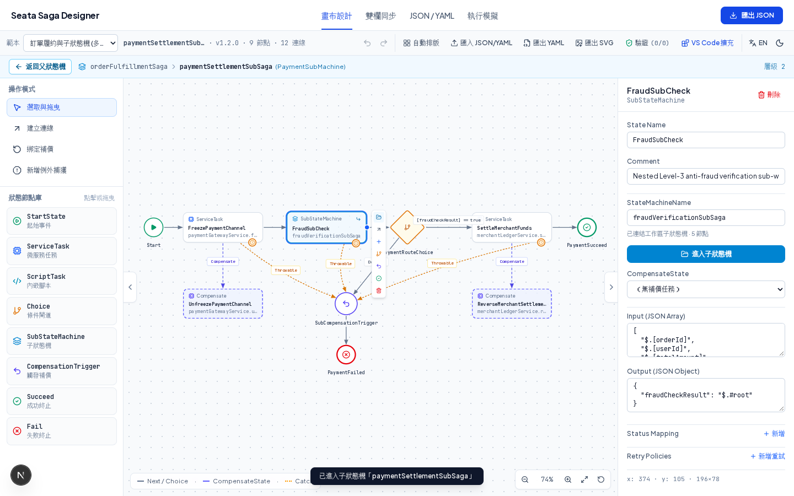
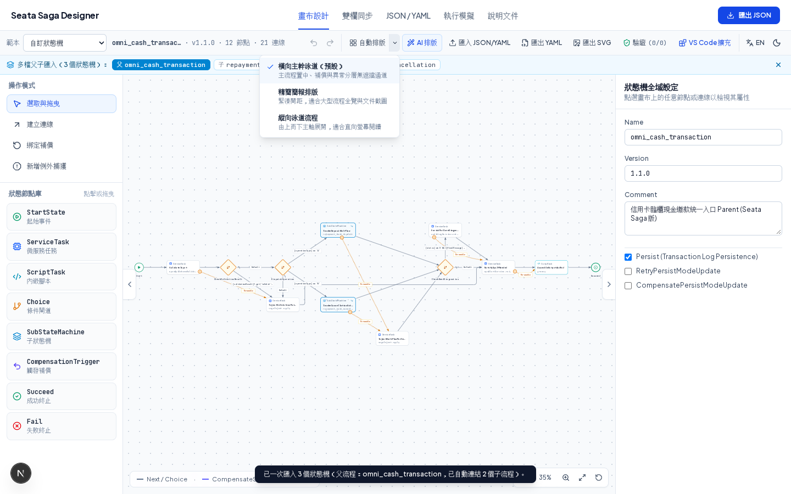

# 05. 多層 SubStateMachine 巢狀子狀態機鑽取

> 透過內建三層巢狀範例（訂單履約 → 支付結算 → 反詐欺驗證），掌握雙擊進入子狀態機、麵包屑返回父層、循環參考防護與獨立復原歷史的完整機制。

**分類**：進階巢狀流程 · **閱讀時間**：6 分鐘閱讀

## 雙擊 SubStateMachine 節點直接進入子狀態機

大型分散式事務往往需要模組化拆分。請在工作列「範本」切換至「訂單履約與子狀態機（多層範例）」，您會在主流程 orderFulfillmentSaga 中看到天藍色雙層卡片樣式的 PaymentSubMachine（SubStateMachine）節點。

只要在畫布上「雙擊」PaymentSubMachine 節點，或是點選該節點後點擊右側屬性面板中的「進入子狀態機」按鈕（亦可使用節點快速工具列最上方的資料夾圖示），畫布就會立即切換並載入對應的 paymentSettlementSubSaga 子狀態機。

*圖 5-1：在頂層 orderFulfillmentSaga 選取 PaymentSubMachine 節點，右側面板即時顯示已連結工作區子狀態機（9 節點）與「進入子狀態機」入口。*

## 多層導覽麵包屑與返回父狀態機機制

進入子狀態機後，工作列下方會自動浮現清晰的層級導覽列（Breadcrumb），顯示完整呼叫路徑（例如 orderFulfillmentSaga > paymentSettlementSubSaga (PaymentSubMachine)）與目前深度（層級 2）。

在 Level 2 的 paymentSettlementSubSaga 中還包含第三層子狀態機節點 FraudSubCheck（指向 fraudVerificationSubSaga），支援繼續雙擊深入至層級 3。隨時點擊左側「返回父狀態機」按鈕、點擊麵包屑中的任意父層名稱，或按下快捷鍵 Alt + ←，皆可瞬間返回父狀態機並自動選取原本進入的 SubStateMachine 節點，確保上下文不遺失。

*圖 5-2：已進入層級 2 的 paymentSettlementSubSaga，頂部提供「返回父狀態機」按鈕與層級麵包屑，畫布內可繼續雙擊 FraudSubCheck 進入層級 3 反詐欺驗證流程。*

## 三層狀態機呼叫堆疊與安全防護設計

為了在真實企業場景中確保多層編排安全可靠，工作區管理引擎（subMachines）實作了四項核心保障：

1. 自動鷹架建立（Auto-Scaffolding）：若雙擊一個尚未定義對應子流程的 SubStateMachine，系統會自動建立含起始點、主服務任務、補償任務與 Succeed 終點的標準子狀態機，無須手動從頭建檔。
2. 循環參考偵測與阻斷：無論是自我呼叫（A → A）或跨層環狀參考（A → B → A），系統都會在雙擊進入與結構驗證階段即時阻斷並發出錯誤提示。
3. 每層獨立 Undo / Redo 歷史：在子狀態機按 Ctrl+Z 只會復原子狀態機本身的編輯，絕不誤刪父狀態機節點。
4. 子狀態機更名連動：在子狀態機修改全域 Name 後，返回父層時其對應節點的 StateMachineName 會自動同步更新。

### 三層 SubStateMachine 呼叫堆疊與防護機制

*架構圖 5-1：orderFulfillmentSaga → paymentSettlementSubSaga → fraudVerificationSubSaga 三層呼叫鏈、獨立復原歷史與循環參考防護。*

## 多檔父子流程批次匯入與實務專案範例

點擊工作列「匯入 JSON/YAML」時，可一次選取最多 30 個父子流程檔案（支援 .yaml、.yml、.json、多文件 YAML --- 與 JSON 陣列）。系統會忽略選檔順序，自動依據 SubStateMachine 的 StateMachineName 依賴圖識別頂層父狀態機並串聯所有子狀態機，並在工作列下方顯示天藍色「多檔父子匯入」快速切換列（標示「父」、「子」、「獨立」），同時即時回報缺少的子流程參照、重複命名或部分語法錯誤。

專案內建 examples/omni-cash-transaction/ 真實實務範例組（包含父流程 omni_cash_transaction.saga.yaml 與兩個子流程 repayment_cash_deposit.saga.yaml、repayment_cash_cancellation.saga.yaml），一次全選匯入即可體驗自動父子連結、雙擊鑽取與多層語意自動排版。

*圖 5-3：一次匯入三支臨櫃現金繳款 YAML 檔案後，頂部自動建立「父 omni_cash_transaction」與兩個子狀態機快速切換按鈕，無須額外設定即可雙擊鑽取。*
