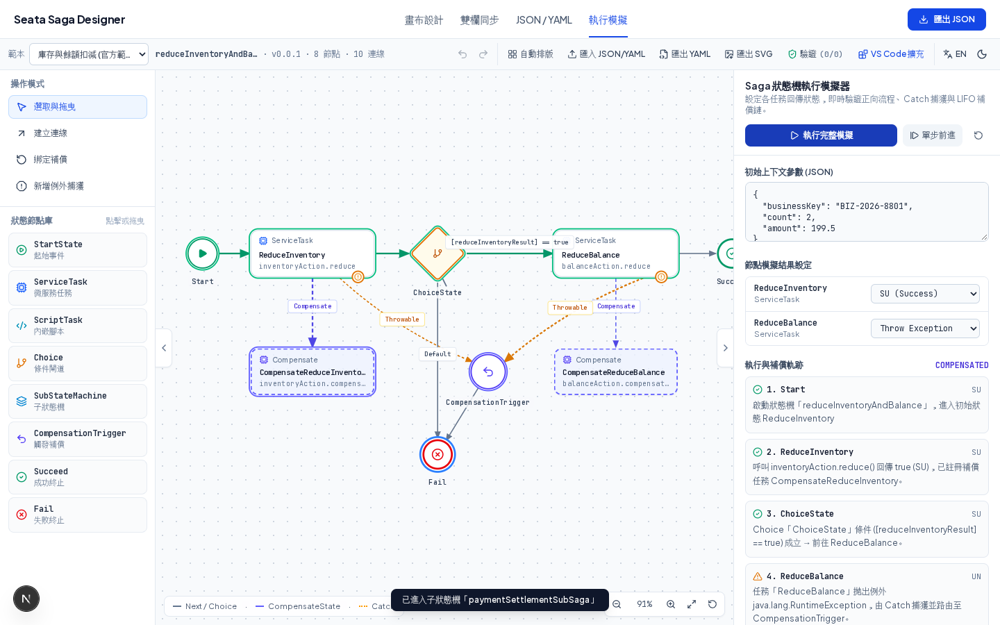
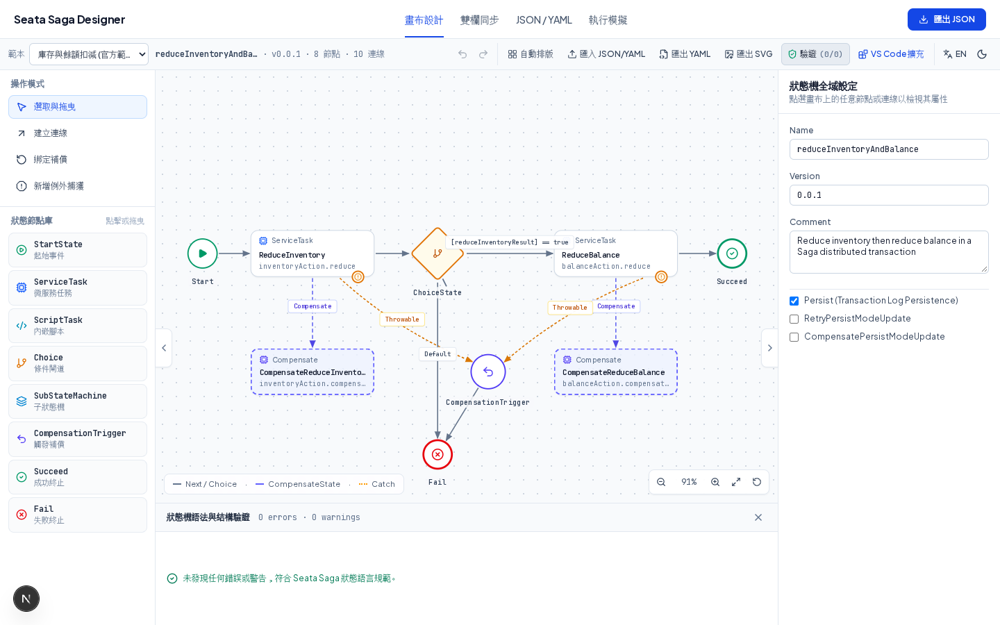

# 06. 拓樸驗證與分散式事務補償模擬

> 使用即時 Seata 規範診斷抽屜與互動式執行模擬器，在部署至正式微服務叢集前完整演練成功提交、異常捕獲（Catch）與 LIFO 反向補償流程。

**分類**：驗證與模擬 · **閱讀時間**：5 分鐘閱讀

## 互動式執行模擬與 LIFO 補償鏈演練

切換至頂部「執行模擬」檢視後，您可以自訂初始 JSON 上下文參數（例如 businessKey、count、amount），並為每個 ServiceTask、ScriptTask 與 SubStateMachine 設定模擬回傳結果：SU（成功）、FA（業務失敗）或 Throw Exception（拋出例外）。

例如在 reduceInventoryAndBalance 中將 ReduceBalance 設為 Throw Exception 後點擊「執行完整模擬」，模擬器會完整走訪 Start → ReduceInventory（註冊補償）→ ChoiceState → ReduceBalance（拋出例外）→ Catch → CompensationTrigger → CompensateReduceInventory（LIFO 反向補償）→ Fail，並在畫布上以綠、琥珀、紫、紅高亮即時標示每一步狀態。

*圖 6-1：將 ReduceBalance 設為 Throw Exception 執行完整模擬後，畫布即時著色顯示執行與捕獲路徑，右側完整列出逐步執行與補償軌跡（COMPENSATED）。*

## Seata Saga 正向執行與 LIFO 反向補償生命週期

模擬器亦支援「單步前進」逐一檢視每一個節點執行前後的 Context 變數變化，並且針對多層 SubStateMachine 提供遞迴子流程模擬，在執行軌跡中清楚顯示跨層的執行與補償步驟。

### Seata Saga 正向推進與 LIFO 補償執行流程

*架構圖 6-1：正向任務每成功一步即推入補償堆疊；當後續任務拋出例外經 Catch 導向 CompensationTrigger 時，引擎依後進先出順序依序執行補償任務。*

## 即時語法與結構診斷抽屜

點擊工作列上的「驗證 (錯誤數/警告數)」按鈕，畫布下方會展開即時診斷清單。點擊清單中任一錯誤或警告項目，系統會自動選取並聚焦於問題節點或連線，協助快速修正。

*圖 6-2：驗證抽屜即時檢核狀態機拓樸完整性，零錯誤與警告時顯示綠色通過提示。*

| 診斷代碼 | 嚴重程度 | 檢核條件說明 |
| --- | --- | --- |
| NO_START_STATE | Error | 狀態機缺少 StartState 起始節點，或 StartState 尚未連接至第一個任務。 |
| MISSING_SERVICE_META | Error | ServiceTask 缺少必填的 ServiceName 或 ServiceMethod 欄位。 |
| EMPTY_SCRIPT | Error | ScriptTask 缺少可執行的 ScriptContent 腳本內容。 |
| SUBMACHINE_SELF_CYCLE | Error | SubStateMachine 的 StateMachineName 指向目前狀態機本身形成無限遞迴。 |
| UNRESOLVED_SUBMACHINE | Warning | SubStateMachine 參考的目標子狀態機尚未在工作區建立定義檔。 |
| UNREACHABLE_STATE | Warning | 畫布上存在無法由 StartState 到達且非補償用途的孤立節點。 |
