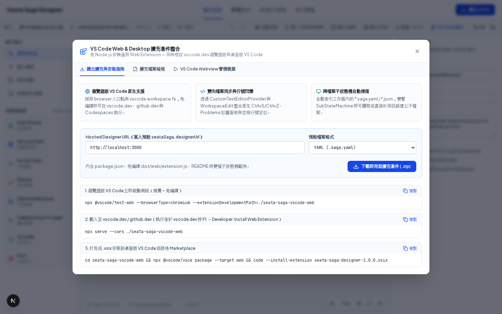
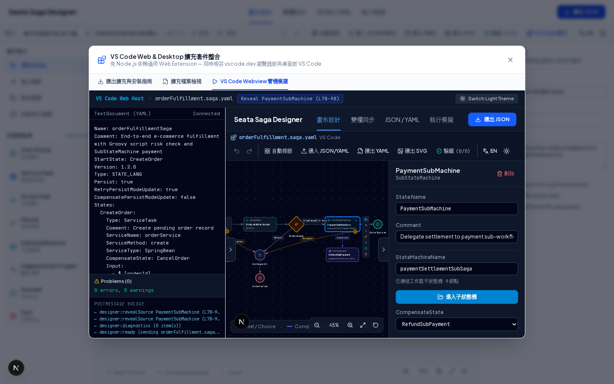

# 07. VS Code 瀏覽器版與桌面版擴充套件整合

> 一鍵下載免編譯、零 Node.js 依賴的通用 VS Code Web Extension，直接在 vscode.dev、github.dev、Codespaces 與桌面版 VS Code 中視覺化編輯 Saga 檔案。

**分類**：IDE 擴充整合 · **閱讀時間**：6 分鐘閱讀

## 一鍵下載即用型 VS Code Web Extension

點擊工作列右側的「VS Code 擴充」按鈕，即可開啟擴充套件整合視窗。系統會自動帶入目前應用程式的 Hosted Designer URL，並即時打包零 Node.js 依賴的通用擴充套件（seata-saga-vscode-web-extension.zip）。

解壓縮後的套件同時宣告 "browser": "./dist/web/extension.js" 與 "main": "./dist/web/extension.js"，全程採用 vscode.workspace.fs 與 Webview API，無須安裝任何 npm 依賴即可直接在瀏覽器版與桌面版 VS Code 執行。



*圖 7-1：VS Code 擴充套件整合視窗提供 Hosted URL 設定、預設格式選擇、一鍵下載 .zip 與 3 種免編譯啟動／打包指令。*

**三種快速啟動與安裝方式**

```bash
# 1. 直接在瀏覽器版 VS Code 測試（免編譯、最快體驗）
npx @vscode/test-web --browserType=chromium --extensionDevelopmentPath=./seata-saga-vscode-web

# 2. 載入至 vscode.dev / github.dev（啟動 CORS 靜態伺服器後於 vscode.dev 按 F1 → Developer: Install Web Extension）
npx serve --cors ./seata-saga-vscode-web

# 3. 打包成 .vsix 安裝至桌面版 VS Code 或發佈至 Visual Studio Marketplace
cd seata-saga-vscode-web && npx @vscode/vsce package --target web && code --install-extension seata-saga-designer-1.0.0.vsix
```

## VS Code Webview 實機模擬與雙向通訊協定

在未安裝到 VS Code 之前，您可以直接切換至彈窗的第三個分頁「VS Code Webview 實機模擬」，立即在瀏覽器內體驗完整的 VS Code Host 雙向同步行為：左側模擬 VS Code TextDocument 原始碼、Problems 診斷面板與即時 postMessage 訊號紀錄，右側則以真實 ?embed=vscode 模式掛載本設計器。

當您在右側視覺畫布點擊任意節點（如 PaymentSubMachine）時，上方宿主狀態列會立即顯示 Reveal PaymentSubMachine (L78-98)，代表在真實 VS Code 中已同步將並排文字編輯器捲動並閃爍高亮第 78–98 行。



*圖 7-2：內建 VS Code Webview 實機模擬介面，展示深色主題同步、窄窗自動收合左側節點庫、即時 Problems 診斷與點擊節點觸發行號定位。*

## 雙環境 Host Bridge 安全架構與設定項目

擴充套件在 Webview 內強制啟用嚴格 Content-Security-Policy，僅允許 https:// 與 http://localhost 來源載入設計器，並透過明確的 Origin 驗證雙向轉發 postMessage 訊息。於工作區開啟 *.saga.yaml / *.saga.json 時會自動掃描同專案子狀態機，支援原生 Ctrl+S 存檔、Ctrl+Z 復原與 Git Diff 檢視。

### VS Code Web / Desktop 雙環境 Webview Bridge 架構

*架構圖 7-1：VS Code Extension Host 透過 CustomTextEditorProvider 與 CSP 驗證中繼層，與 Next.js 設計器完成雙向檔案、子狀態機與診斷同步。*

| VS Code 設定項 | 預設值 | 功能說明 |
| --- | --- | --- |
| seataSaga.designerUrl | 當前應用程式網址 | 指定 Webview 載入的 Seata Saga Designer 託管網址（僅接受 https 或 localhost）。 |
| seataSaga.defaultFormat | yaml | 建立新狀態機或自動建立子狀態機檔案時的預設格式（yaml 或 json）。 |
| seataSaga.syncDiagnostics | true | 是否將即時拓樸驗證錯誤與警告同步顯示至 VS Code「問題（Problems）」面板。 |
| seataSaga.autoScanSubMachines | true | 是否自動掃描工作區內的 *.saga.* 檔案以支援跨檔 SubStateMachine 雙擊鑽取。 |
