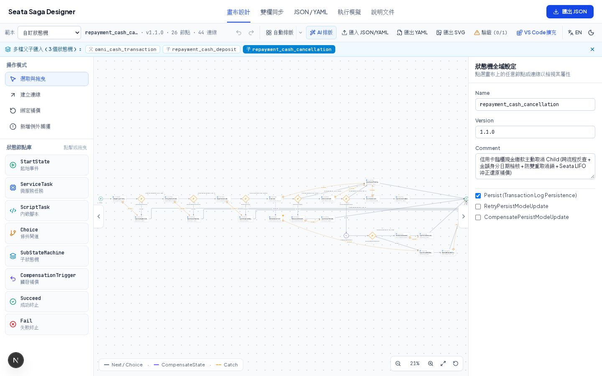
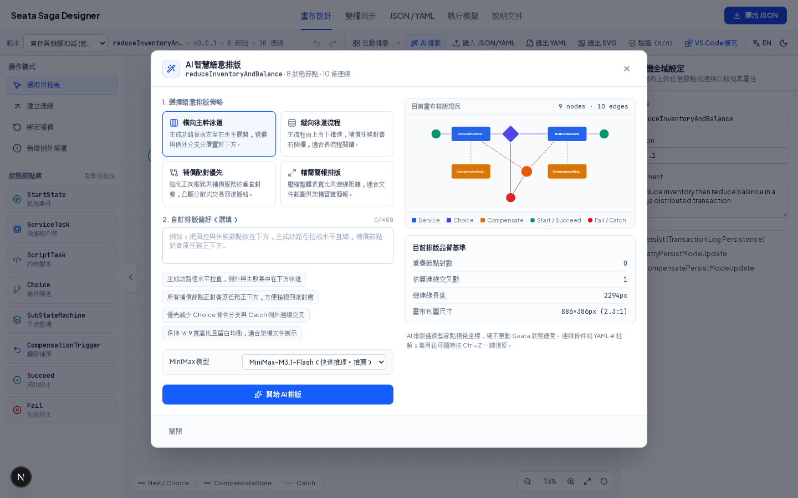

# 09. 多層語意自動排版、360° Catch 錨點與 AI 排版

> 深入掌握針對大型實務 Seata Saga 流程設計的五層語意泳道自動排版、360° 可拖曳 Catch 邊界錨點、無遮擋圓角通道繞道，以及整合 MiniMax 模型的 AI 智慧語意排版。

**分類**：排版與繞道引擎 · **閱讀時間**：6 分鐘閱讀

## 五層語意泳道自動排版與三種內建模式

針對真實企業級分散式交易（如 27 個節點、44 條連線的臨櫃現金取消流程 repayment_cash_cancellation.saga.yaml），傳統最短路徑 BFS 排版容易讓共用的 Succeed 終點卡在畫布中央、造成大量回頭箭頭與長連線穿越節點。

全新自動排版引擎（lib/saga/autoLayout.ts）改採無環 DAG 最長路徑分欄與五層語意泳道架構：自動將主流程置中為 0px 水平中軸（Band 0），將逾時／對帳查詢／診斷分流上移至上層泳道（Band -1），將配對的 CompensateState 補償任務精準垂直對齊於原任務正下方並搭配直接拒單處理（Band +1），並將 CompensationTrigger 回滾鏈（Band +2）與補償失敗告警／Fail 終點（Band +3）分層排列；Succeed 終點恆定置於最末端，確保零節點重疊、零逆向回頭連線、零連線穿過節點與零標籤遮擋。

點擊工作列「自動排版」按鈕可立即以目前選用模式重排並自動適應畫面；點擊右側下拉箭頭可快速切換三種風格：「橫向主幹泳道（預設）」、「精簡簡報排版」（壓縮寬圖欄距，適合大型流程全覽與文件截圖）與「縱向泳道流程」（由上而下主軸展開，動態計算節點標籤高度避免擁擠）。



*圖 9-1：27 個節點、44 條連線的 repayment_cash_cancellation 實務取消流程，經五層語意泳道排版與圓角通道匯流排繞道後，於 21% 縮放完整呈現在畫布內（0 節點重疊、0 連線穿越、0 逆向連線）。*

### 四階段自動排版與無遮擋通道繞道管線

*架構圖 9-1：從語意泳道分類、DAG 最長路徑分欄，到 360° Catch 動態錨點、圓角通道匯流排與零碰撞標籤定位的完整管線。*

## 360° 動態 Catch 邊界錨點與無遮擋圓角通道繞道

過去 Catch 例外連線僅固定從來源節點下緣出發，拖曳目標節點至右側或上方時容易拉出橫越節點本體的雜亂線段。現在系統會即時依據目標方向在來源節點的上、右、下、左四個邊界自動定位橘色 Catch 錨點（⚡），並主動錯開同側既有的 Transition 或 Compensation 連線；若同一對節點同時存在正常轉移（Transition）與例外捕獲（Catch），系統會自動保持 Transition 直線並將 Catch 朝外側平滑拱起分離。

使用者亦可直接按住節點邊框上的橘色圓形錨點沿四邊自由拖曳，或在右側屬性面板指定錨點邊界與比例（ratio 0.1–0.9）；手動位置會持久化至 style.sourceAnchor（支援 JSON、YAML 註解保留與 SVG 匯出），雙擊錨點或執行自動排版即可恢復自動追蹤。對於跨越多欄的長跳躍連線（如前置檢核失敗直達 Succeed），繞道器會自動升級為泳道間隙內的圓角正交匯流排（10px 平行分道），確保線段絕不切穿任何無關節點。

| 操作方式 | 行為說明 | 序列化結果 |
| --- | --- | --- |
| 預設自動追蹤 | 拖曳目標節點時，橘色 Catch 錨點自動沿四邊轉向並避讓同側其他連線。 | 不寫入 sourceAnchor，保持純淨定義。 |
| 拖曳橘色錨點 | 沿來源節點上／右／下／左邊緣自由移動釘選位置，即時預覽繞線與標籤。 | 於該條 Catch 物件寫入 style.sourceAnchor: { side, ratio }。 |
| 屬性面板微調 | 選取 Catch 連線後，在右側面板選擇自動或四邊方位與 10%–90% 位置滑桿。 | 同步更新畫布、JSON/YAML 與 SVG 匯出。 |
| 雙擊橘色錨點 | 一鍵解除手動釘選，恢復 360° 智慧自動追蹤模式。 | 移除 style.sourceAnchor 欄位。 |

**Catch 錨點手動釘選於 YAML 的儲存格式（關閉「包含畫布座標」時會自動省略）**

```yaml
Catch:
  - Exceptions:
      - java.lang.Throwable
    Next: NotifyOpsIfNeeded
    style:
      sourceAnchor:
        side: right
        ratio: 0.72
```

## MiniMax AI 智慧語意排版（300 秒上限・可中途取消・耗時回報）

除了即時零延遲的本機自動排版，點擊工作列「AI 排版」可開啟 MiniMax 語意排版視窗。視窗內建 4 種語意策略（橫向主幹泳道、縱向泳道流程、補償配對優先、精簡簡報排版）、4 組常用提示詞快捷膠囊與 400 字自訂自然語言排版偏好，並可於 MiniMax-M3.1-Flash（快速推薦）、MiniMax-M3（深度推理）與 MiniMax-M2.5 之間自由切換。

所有 AI 呼叫皆透過伺服器端 Next.js API Route（/api/saga/ai-layout）代理轉發，前端不接觸 API 金鑰。為因應大型深度推理模型回應時間，逾時上限已提升至 300 秒，執行期間畫面即時顯示 mm:ss 經過時間計時器並提供「取消」按鈕（透過 AbortController 即時中止前後端請求）；成功產生後會顯示總共耗時、前後對比 SVG 縮圖與量化品質指標（重疊節點數、連線交叉數、包圍尺寸與長寬比），並經本機碰撞消解與泳道對齊精修後一鍵套用（可隨時 Ctrl+Z 復原）。



*圖 9-2：MiniMax AI 智慧語意排版視窗，提供 4 種排版策略、快捷提示詞、MiniMax 模型切換、目前畫布縮圖與量化品質基準，支援最高 300 秒逾時、即時取消與耗時統計。*

> **未設定 MINIMAX_API_KEY 或離線環境下的無縫備援**
> 若伺服器尚未設定 MINIMAX_API_KEY 或部署於純靜態 GitHub Pages 環境，AI 排版視窗會顯示清楚診斷訊息並提供「改用本機自動排版」一鍵備援按鈕，隨時享有同等五層泳道與無遮擋通道繞道品質。
